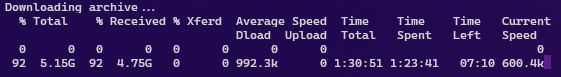

# OPLNova API

Lightweight service written in V that provides game metadata and artwork for the [OPLNova](https://code.weexnes.dev/OPLNova) PS2 game manager.

[](https://code.weexnes.dev/oplnova_vapi/~builds)
[](https://vlang.io/)

## Features

- **Game metadata lookup:** search for game titles by normalized game IDs.
- **Artwork serving:** access to game-specific artwork stored in the server's database.

## Requirements

- A `db/` directory containing game data. It can be set up automatically with the provided setup script (see below).

## Install

### Database setup

To download and prepare the required game data and artwork, run:

```bash
bash setup_db.sh
```

> [!NOTE]
> The database is downloaded from Archive.org and may take a **significant amount of time** depending on your network speed.



### Binary

Download the latest binary from [code.weexnes.dev/oplnova_vapi/~builds](https://code.weexnes.dev/oplnova_vapi/~builds),
or build it yourself (see [Build from source](#build-from-source)).

## Usage

The API runs on port `3000` by default.

### Endpoints

| Method | Endpoint | Description |
| :-- | :-- | :-- |
| `GET` | `/` | Serves the main landing page (`index.html`). |
| `GET` | `/contact` | Serves the contact page (`contact.html`). |
| `GET` | `/search/:id` | Returns JSON metadata for a given game ID (e.g. `/search/SCES12345`). |
| `GET` | `/art/:file` | Serves artwork files from `db/PS2/` (e.g. `/art/cover.png`). |

## Build from source

Prerequisites: the [V language](https://vlang.io/).

```bash
v run api.v
```

## License

This project is part of the [OPLNova](https://code.weexnes.dev/OPLNova) ecosystem.
